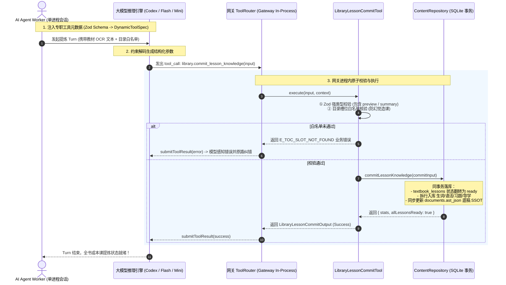

# Lingua Studio - 原生工具调用 (Native Tool Calling) 与结构化 JSON 提示词原理对比与架构演进指南

> **文档归属**：`docs/ai-pipelines/tool-calling-vs-json-prompting.md`  
> **版本**：v1.0 (2026-09-29)  
> **面向对象**：后端工程师、AI Agent 开发者、系统架构师  
> **核心原则**：[AGENTS.md](../../AGENTS.md) §1.6（Native Tools First 原生工具调用优先于 MCP 与自由文本）、§1.6b（专精工具白名单与会话设防）、§2.1（Result 模式防御）

---

## 1. 核心问题与背景 (The Problem Statement)

在语言教材的数字化与智能提炼过程中，我们需要大模型将原本凌乱的 OCR 文本/排版内容，转换为高度结构化的教学资产：
- 课前预习导学卡片（`preview`：核心攻坚要点、易错避坑预警、Can-do 生活目标）；
- 规整的精读课文全文 Markdown（`passageMd`：包含段落对照、发音注音、角色对白）；
- 核心生词库（`vocabularies`：词面、假名读音、词性、中文释义、声调、课文双语例句）；
- 核心语法与知识点（`knowledgePoints`：接续规则、详细用法剖析、双语高质量例句）；
- 课后习题与解析（`exercises`：单选、填空、翻译，配标准答案与保姆级排除法解析）；
- 课后总结与记忆清单（`summary`：核心黄金骨架句、睡前自我检视清单）。

在实现此类复杂结构提取时，工程师通常会面临两种技术路线的抉择：
1. **传统的纯文本 JSON 提示词模式（Prompted JSON Text）**：在系统提示词或用户提示词中书写冗长的 JSON Schema 格式说明或示例，要求模型“必须且仅输出合法的 JSON 格式”，然后由外部程序通过正则表达式截取并用 `JSON.parse` 解析。
2. **现代原生工具调用模式（Native Tool Calling / Function Calling）**：将数据结构定义为系统原生工具（如 `library.commit_lesson_knowledge`），由网关运行时直接将 Zod 生成的 JSON Schema 注入底层模型。模型不再输出聊天回复，而是直接发起结构化的 `tool_call`，由网关在进程内执行原子校验与数据库落盘。

本文档深入剖析两者的底层运行机制差异、为什么纯文本 JSON 是生产级高可用系统的脆弱反模式（Fragile Anti-pattern），以及 Lingua Studio 为何将**原生工具调用定为不可动摇的一等公民（First-Class Citizen）**。

---

## 2. 机制对比：模型底层与运行时维度剖析 (Deep Mechanical Comparison)

| 核心维度 | 传统纯文本 JSON 模式 (Prompted JSON Text) | 现代原生工具调用模式 (Native Tool Calling) | 优劣判定 |
| :--- | :--- | :--- | :--- |
| **底层采样机制 (Sampling Engine)** | **自由无约束采样**：自回归模型在词表（Vocab）全空间中根据概率逐字生成。极易因概率采样产生标点符号漂移、引号未转义或格式破损。 | **约束解码 (Constrained Decoding)**：现代推理引擎（如 OpenAI Responses, Gemini Function Calling, Claude Tool Use）在解码阶段挂载语法树（Grammar/Schema Mask），强制限制下一个 Token 只能符合 Schema 规范。 | **工具调用完胜**（数学上杜绝字段缺失与非法类型） |
| **Markdown 污染与包裹破损** | **极高**：模型极度倾向输出 ````json ... ````，或在首尾附带无用客套话（如 *"Here is the extracted JSON:"*）。长课文中若出现双引号或换行，极易直接击崩外层 `JSON.parse`。 | **零污染**：工具调用的参数走专用结构化信封通道（Protocol Envelope），与普通聊天文本完全解耦，根本不会产生代码块包裹或 Markdown 语法干扰。 | **工具调用完胜**（彻底废除手写脆弱正则） |
| **错误反馈与自愈能力 (Reflection Loop)** | **无自愈闭环（单向死胡同）**：若模型输出的 JSON 语法损坏或字段缺失，外层程序报错直接中断。模型本身根本不知道自己生成失败，更无法在当前对话轮次中纠偏。 | **双向自纠错闭环**：若工具调用参数触发业务拦截（如 `E_TOC_SLOT_NOT_FOUND` 或 Zod 校验失败），网关经 `submitToolResult` 将错误原路回填，模型可在同一 Turn 立即感知并自动重试修复。 | **工具调用完胜**（极大提升自动化批处理成功率） |
| **执行位置与网络/进程开销** | **外层多跳胶水代码**：模型输出大段纯文本 -> 调度器读出文本 -> 正则清理 -> JSON 反序列化 -> 业务字段映射 -> 手动调用仓储落地。中间环节冗长。 | **进程内原地原子执行 (In-Process)**：网关接收到 `tool_call` 后，直接在本进程的 `ToolRouter` 触发工具的 `execute` 方法，在同一个事务内原子落库并翻转槽位状态。 | **工具调用完胜**（链路极短，无胶水开销） |
| **Token 消耗与上下文窗口** | **高冗余消耗**：每次 Prompt 都要附带数百甚至上千 Token 的「伪代码/示例 JSON」，极大侵占模型宝贵上下文，增加首字延迟（TTFT）与费用。 | **紧凑高效**：工具定义作为系统级元数据由底层协议发送，提示词只需点名工具即可，有效上下文空间完全留给真实的教材正文与 OCR 文本。 | **工具调用完胜**（高吞吐场景显著省钱提速） |
| **权限隔离与安全设防** | **无状态防御**：大模型自由生成任何字段，外部程序若不仔细校验，极易发生提炼数据越权、无目录造课或脏数据污染。 | **专精会话白名单（AGENTS.md §1.6b）**：每个专职 Worker 严格绑定其声明的专精工具，未登记的工具调用在执行侧被安全屏障直接拒绝。 | **工具调用完胜**（架构安全 fail-closed） |

---

## 3. 为什么纯文本 JSON 提示词是脆弱的反模式？(The Failure Modes of Raw JSON)

在数十万字的真实外语教材批量提炼中，纯文本 JSON 会在以下经典场景中频繁失控：

### 3.1 场景一：课文长文本 Markdown 引号逃逸破损
教材课文通常包含大量角色对白，如：
```json
{
  "passageMd": "佐藤先生は「今日は\"て形\"の練習をします」と言いました。"
}
```
自回归模型在生成深层嵌套的长对白时，极易忘记在内部双引号前加转义反斜杠（`\"`），直接导致整本教材几万字符的提取结果在 `JSON.parse` 时抛出 `SyntaxError: Unexpected token`，整课提取付诸东流。

### 3.2 场景二：大模型上下文截断（Truncation Disaster）
当遇到内容极为丰富的长章节时，大模型如果采用纯文本输出，一旦达到 `max_tokens` 上限，会在 JSON 输出到一半时被截断（例如在 `"exercises": [` 数组中间截断）。由于末尾缺少闭合的括号 `}` 与 `]`，整个 JSON 结构全毁，没有任何字段可以被程序挽救。

而在原生工具调用体系下，工具调用属于原子参数传输，推理引擎底层会根据工具调用协议进行整包封装或明确汇报截断事件，网关能够精确捕获并触发单课安全重试。

### 3.3 场景三：幻觉脱靶造课（Hallucinated Phantom Lessons）
在纯文本 JSON 模式下，大模型常常出现过度发挥的幻觉，自行臆造并不存在于原书中的课次（例如凭空多输出一个 `"lessonId": "l999"`）。纯文本模式对外层没有校验约束；而原生工具 `LibraryLessonCommitTool` 会在入库第一行强制执行目录白名单拦截：
```typescript
if (!catalogSlots.has(input.lessonId)) {
  return err(new BusinessError('E_TOC_SLOT_NOT_FOUND', `章节槽位 ${input.lessonId} 脱离预置目录`, 'VALIDATION'));
}
```
模型立即收到工具执行失败的回执，从而在同一次 Turn 中收敛行为。

---

## 4. Lingua Studio 原生工具调用架构实现 (Architecture Implementation)

系统完整实现了符合 **AGENTS.md §1.6** 的工具调用闭环体系：



### 4.1 强类型工具契约：`LibraryLessonCommitTool`
工具的输入 Schema 由 Zod 强类型声明，单一事实源（SSOT）生成模型可见参数约束：
```typescript
export const LibraryLessonCommitInputSchema = z.object({
  documentId: z.string().min(1).describe('所属教材文档ID'),
  lessonId: z.string().min(1).describe('目标课次槽位ID（必须为已落库目录中存在的槽位ID，如 l1, l2）'),
  title: z.string().optional().describe('大模型精校后的课文标题'),
  passageMd: z.string().optional().describe('精读课文全文 Markdown'),
  vocabularies: z.array(VocabSchema).optional().describe('核心生词列表'),
  knowledgePoints: z.array(GrammarSchema).optional().describe('核心语法与知识点列表'),
  exercises: z.array(ExerciseSchema).optional().describe('课后习题与保姆级解析'),
  preview: z.object({
    keyPoints: z.array(z.string()).optional().describe('核心掌握要点清单'),
    pitfalls: z.array(z.string()).optional().describe('高频易错避坑预警'),
    canDoGoal: z.string().optional().describe('实际语言应用目标（Can-do）'),
  }).optional().describe('课前预习导学卡片'),
  summary: z.object({
    goldenSentences: z.array(z.string()).optional().describe('本课黄金核心句'),
    selfCheckQuestions: z.array(z.string()).optional().describe('课后自测检验清单'),
  }).optional().describe('课后总结自测卡片'),
});
```

---

## 5. 双轨融合与安全降级设计 (Dual-Mode & Fallback Strategy)

尽管原生工具调用拥有绝对优势，在复杂的工业级实际部署中，系统依然需要面对极端异构场景：
1. **轻量边缘模型**：部分离线开源小模型或受限代理通道可能对 Function Calling 协议支持不完整；
2. **离线集成测试与 Mock 管道**：单元测试中快速模拟纯文本返回，无需构造庞大的工具循环模拟器。

因此，Lingua Studio 的 [`LessonBatchExtractor`](../../apps/gateway/src/modules/library/application/lesson-batch-extractor.ts) 采用了**工具调用优先、文本解析兜底（Tool Calling First with Safe JSON Fallback）**的双轨设计：

```typescript
// 1. 原生工具调用优先：若底层 Agent/Worker 通过 tool_call 回填了结构化参数
const toolCall = responseToolCalls?.find(
  (tc) =>
    tc.name === 'library.commit_lesson_knowledge' ||
    tc.name === 'library_commit_lesson_knowledge'
);

if (toolCall) {
  const parsedToolInput = ExtractedLessonSchema.safeParse(toolCall.input);
  if (!parsedToolInput.success) {
    return err(new BusinessError('E_LLM_SCHEMA_INVALID', `工具调用参数不合法: ${parsedToolInput.error.message}`, 'VALIDATION'));
  }
  extracted = parsedToolInput.data;
} else {
  // 2. 文本解析兜底：处理标准或代码块包裹的 JSON 字符串（自适应代码块修整与安全拦截）
  const parsedResult = parseLessonExtractionJson(responseText);
  if (!parsedResult.ok) {
    return parsedResult;
  }
  extracted = parsedResult.value;
}
```

### 提示词策略（Prompt Strategy）：
在提示词模板 [`lesson-extraction-prompt.ts`](../../apps/gateway/src/modules/library/application/prompts/lesson-extraction-prompt.ts) 中明确向模型宣示规则：
```text
【工具调用与输出规范】：
1. 工具优先模式：本会话已注入 `library.commit_lesson_knowledge` 工具。请直接调用该工具提交提炼出的完整教学内容（必须包含 documentId 与 lessonId）。严禁在普通聊天文本中闲聊。
2. 格式兜底模式：若所在运行环境受限无法调用工具，才必须输出对应结构的合法 JSON 格式作为兜底，严禁包含任何前言、结语或解释。
```

---

## 6. 总结与工程规范准则 (Engineering Invariants)

1. **绝对禁止退回纯文本对话拼装**：涉及数据库持久化状态变更、目录入库、错题提交等关键写入操作，必须通过系统 Server Tools 发起，严禁让 Agent 输出带有业务指令的聊天自然语言要求客户端代为执行；
2. **工具 Schema 即第一事实源（SSOT）**：所有业务字段的演进（如扩充 `explanation`、`preview`、`summary`）必须优先在 Zod Schema 中登记并同步更新测试用例，杜绝 Schema 与业务代码双源漂移；
3. **白名单校验与目录防脱靶**：任何章节级提炼工具必须强制核验已建成的目录槽位白名单，脱离大纲凭空造课必须在工具层 `fail-closed` 拦截；
4. **模型分级匹配（Task-Model Tiering）**：结构化提取与格式化属于确定性极强的中轻度 NLP 任务，应优先向用户推荐轻量高性价比模型（Flash / Mini 等），避免无意义算力浪费。
