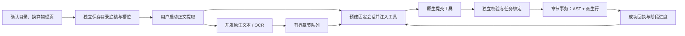

# Lingua Studio 教材导入架构

更新：2026-10-01，按用户批准的目录与运行监视计划分步实施。产品入口是 Tauri 桌面；`apps/web` 是桌面 WebView 的 React 代码目录。

## 运行监视（P2）

目录定位、目录模型与独立保存、正文任务共享 `traceId`；创建前没有教材/job 身份，后续事件保存实际身份。桌面“目录运行详情”“运行详情”及章节点击入口只显示本次记录。实际提示词、原生工具注册信息、公开模型事件、提交候选、校验、重试与数据库事务回执由 Gateway 捕获，不补造此前未记录的历史。

诊断写入固定 `textbook_import_events`（v035）。列表只查元数据，正文/参数详情点击后查询；流式文本按活动批次合并，SSE 用全局递增 sequence 补取并去重。关闭重开读回持久化历史；各会话未结束的当前轮次展开，结束轮次折叠。会话工具定义来自 Adapter 实际注入声明；引擎没有提供时明确显示为空，不能另造 schema。

校验候选与历史事务回执保留在交互记录；“查询数据库当前保存内容”读取当前 AST 版本并附读取时间，两者分别展示。事件存储失败显示记录不完整，不能把已经提交的教材改判失败。目录模型返回时赋予草稿 ID，并按工具提供的父下标转换 parentId；桌面不再猜父节点或重建保存身份。

验收覆盖真实工具/Repository/SQLite 两 Worker 记录、SSE 游标补取、数据库重开、用户隔离、诊断失败，以及隔离 DOM 运行时里的真实 Base UI 弹窗关闭重开、历史折叠与按需读取。模型是受控测试边界，未试跑真实模型或处理现有教材。

## 导入路径

1. 原生文件选择器取得本地 PDF 路径。Gateway 读取文件，按 SHA-256 查询当前用户已保存的教材；改名不改变身份，同名不同文件不匹配。
2. 检测展示实际逐课正文、生词、知识点、习题及预习/总结统计。已有教材全部就绪可直接打开；部分完成可复用已确认目录，只处理未完成课次。完成判断不使用数量阈值或名称推测。
3. 新教材通过书签/局部探测选择目录范围，经专用模型工具提交目录草稿。用户确认时按“印刷页码 + 本次目录结束页”换算 PDF 物理页，调用独立保存接口立即建立目录底稿与章节槽位，并保存文件指纹，不需要启动正文提取。结果可整体或逐项修改并独立保存。再次选择同一份文件自动载入已存目录；明确点击重新识别才启动探测和模型。
4. OCR 生产者与固定 Agent 会话池初始化同时启动。一章文字就绪即交给有界队列；会话空闲即可消费，结果通过原生提交工具校验保存。
5. 每章提交成功立即发布已保存统计；全部课次实际 `ready` 才完成。失败章可重试，已保存章默认跳过。界面按目录顺序展示。

## 职责和会话生命周期

### 2026-10-01：目录任务与模型输入（P1）

任务清单由统一的 `planTextbookTasks` 按实际目录 ID/父节点生成。一课包含其子目录；课次以外的独立小节也组成任务。单元/章容器汇总子任务，父项缺失、循环或无内容子项显式拒绝。目录复用保留四级层级、ID 和父节点，不按上一课或相似标题重建关系。

模型实际输入携带目录路径和本任务的完整条目（ID、标题、层级、父节点、顺序、物理起止页）及对应文本。任务可以乱序完成，读取按目录顺序。原生提交只允许任务锚定节点；容器不要求生成虚构正文。

进度、导入检测和 `allLessonsReady` 覆盖独立部分；现有计数字段 `lessonCount/totalLessons` 在流水线与检测中统计提取部分，桌面明确显示“部分”，另显示实际目录项和课次数。目录保存回执及 AST 的 `totalLessons` 仍表示课次数。

P1 集成验证实际会话收到的目录结构和页码、独立部分失败时不能全书完成、恢复只处理未完成部分，以及桌面重用目录保持原始身份和层级。模型输出为受控替身，不代表真实模型语义质量已验收。

| 位置 | 职责 |
| --- | --- |
| `application/textbook-outline.ts` | 文件指纹匹配、独立确认保存目录；不启动 OCR/Agent |
| `application/textbook-pipeline.ts` | 固定目录、启动两侧、队列背压、阶段重试、取消和结算 |
| `application/pdf-import/lesson-content-slicer.ts` | 按物理页提取文字，真实扫描件进入原生 OCR，单章失败隔离 |
| `application/lesson-batch-extractor.ts` | 固定数量会话、工具注入、模型发送与事件消费；没有 Repository 依赖 |
| `tools/library-lesson-commit-tool.ts` | 已登记会话的执行入口；只允许当前用户/章节/尝试提交 |
| `application/lesson-submission.ts` | 参数格式、目录覆盖、来源、题型校验；登记有效候选与保存回执 |
| `storage-sqlite/adapters/library/commit-lesson-knowledge.ts` | 提交身份和规范 AST 同事务保存，所有行表由底稿派生 |

正文入口使用现有 `AgentAdapter` / `AgentSession`。本轮替换了缺少自定义原生工具回执接口的 `agentpools` 教材入口；不增加厂商业务依赖。

池内正常会话持续复用；当前 Turn 结束、绑定解除后才接下一章。同章格式重试保留同一线程，新的尝试 ID 拒绝旧提交。仅运行时故障触发会话替换，并记录故障原因；替换失败结算该章，其他 worker 继续。初始化失败不静默缩小池。

工具成功回执以事务提交为准。已保存后发生 Turn 故障仍算成功。普通文本、JSON 文本和 Turn 完成均不能代替工具回执。提示词包含本次任务 ID、语言、目录、正文、补充习题设置和工具名称，没有示例或 JSON 模板；原生协议所需参数 Schema 只走工具注册。

## 规范章节内容

P4 阅读使用同一任务规划，保留独立 `section` 入口，课次数量只统计实际 `lesson`。各任务保留真实祖先路径及子树；正文、生词、知识点、习题按 `tocId` 和实际父子关系呈现标题与物理页。来源在目录内容组显示，知识点原书讲解、AI 讲解和例句独立展示。不按文字内容猜归属，也不自动拆分或重写已存混写段落。

运行详情“模型候选”以实际工具参数渲染，不等同保存成功；“数据库当前保存版本”按需读取 AST，并查询派生行数量，显示读取时间与节点身份。两处共用目录内容展示组件，原始记录字段仍可展开。历史目录标题来自本 trace 的启动快照，不用当前教材覆盖当时的目录。

P3 提交校验先检查字段格式，再比较当前 `documentId/lessonId/assignmentId`，记录具体字段、实际值、期望值及 call ID；有权限的会话可修正旧身份，但错误身份永不替换后放行。全部内容及 AI 例句需有本任务内 `tocId`。拒绝后显示“等待模型修正”；新 Turn 与仅保存重试使用不同阶段。

模型首响应与无活动期限集中在 `TextbookPipelineSettingsSchema`，默认分别 60000 / 120000 毫秒，桌面可配置并记住。公开响应活动重置后续期限，超时撤销本次工具提交资格并中断 Turn；迟到提交不能写入。正常章节与格式重试仍复用线程，运行时故障才替换会话。已校验候选保留给保存重试。

唯一契约：`packages/document-model/src/lesson-content.ts`。

- `coverage`：当前章及全部子目录 ID 逐项报告 `EXTRACTED` / `UNREADABLE`。缺项、未知 ID、无法辨认或没有关联内容的小节不能标记成功。
- `blocks`：`PARAGRAPH` / `DIALOGUE`，文字、角色、译文和来源明确。正文是模型纠错后的结构，不保存 OCR 文本作为正式正文，不用 Markdown 正则猜角色。
- `vocabularies`：词面、读音、词性、释义、声调、独立 `aiExplanation` 和例句；AI 讲解不混进 `gloss` 或正文。v036 将讲解同事务派生到 `textbook_vocab.ai_explanation`。
- `knowledgePoints`：原书 `textbookExplanation` 与补充 `aiExplanation` 分开，例句各自记录来源。
- `exercises`：单选、多选、填空、翻译、排序、匹配、简答；答案分别使用 `text`、`optionIds`、`pairs`，检查选项引用、排序覆盖和匹配结构。
- `source` 为 `TEXTBOOK` / `AI`；译文、注音、释义、答案、解析、接续的字段来源另记。原书题干可以搭配 AI 答案和解析。
- 新增 AI 习题无需原书目录有练习项，但不能替代原书已有目录项的覆盖要求。用户可以关闭新增习题。
- 预习和总结属于 AI 导学。桌面渲染显示来源；阅读保持 TTS、收句子和导师入口。

目录与格式校验只提供结构证据，不能证明正文语义完全正确或原书没有遗漏。会话复用保留历史上下文，提交绑定约束写入归属，不宣称清空模型上下文或消除历史 token 成本。

## 存储

六层映射：`documents` → `textbook_lessons` → `textbook_lines` → `textbook_vocab/textbook_grammar` → `textbook_exercises`。底稿 `documents.ast_json` 是 SSOT。

目录条目存于现有 `textbook_lessons`（标题、层级、父节点、顺序、物理起止页），这张表同时承担章节槽位和状态，不额外创建 `textbook_toc`。`POST /api/documents/:userId/textbook-outline` 经既有事务保存底稿和派生目录行；新目录状态为 `pending`，检查结果明确提示“目录已保存，正文尚未提取”。后续提取沿用返回的教材 ID。再次确认同书同标题和物理页的条目复用原身份，保留已就绪正文；没有授权覆盖时，遗漏已就绪条目会拒绝写入。

每章在一个短事务内：检查既有课次槽位、检查 `submission_id`、更新规范 AST、全删全插派生行与 FTS、提交。乱序完成不会改变目录 `sort_order`。同次提交重复调用返回已存内容，不重复覆盖。任一派生写入失败，AST、正文及 ready 状态整体回滚。

v034 同步最新 DDL、Drizzle schema 和前向迁移：

| 表 | 新增字段 |
| --- | --- |
| `textbook_lessons` | `content_json`、`submission_id` |
| `textbook_lines` | `block_id`、`kind`、`source`、`toc_id`、`field_sources_json` |
| `textbook_vocab` | `source`、`toc_id`、`field_sources_json` |
| `textbook_grammar` | `source`、`toc_id`、`ai_explanation`、`field_sources_json` |
| `textbook_exercises` | `source`、`toc_id`、`answer_json`、`content_json`、`field_sources_json` |

`passage_md` 是整理后正文的文本投影，不是正文解析入口。词汇、知识点和正文派生时不再截断内容。结构化 JSON 导入也经同一 AST 校验和投影；客户端保存规范 AST，展示模型不写成底稿。

旧教材示例、补种、旧状态推测和文本 JSON 回填已删除，不做教材数据兼容。已发布迁移保留，新维度通过前向版本升级。本轮开始前已只读核对仓库库和桌面库教材为空，没有再次清库。

## OCR、资源和重试

当前固定原生版本 `1.18.2-inkdown.1` 已有 NAPI AsyncTask、Rayon 页识别池及模型缓存。PDFium 页面渲染串行，识别可并行；应用不新增 JS worker 或 OCR 子进程。

首个真实扫描批次初始化引擎，结果归入当前章，其他 OCR 请求等待其完成，避免冷启动重复构造。每个原生批次复用现有 `MAX_OCR_PAGES_PER_IMPORT` 上限；一章可由多批文字组成。重试保留成功批次，不重复识别。应用限制同时提取的章节和队列容量，并计入 NAPI 的 PDF 字节复制开销。

桌面记住模型、思考等级、会话数、OCR 章节并发、队列容量、各阶段重试预算和补题偏好。默认和范围集中在 `textbook-pipeline-settings.ts`；不硬编码模型或教材内容。原生线程数由底层 CPU 策略决定，章节并发不等同于识别线程配置。

OCR 故障只重试当前章；格式/覆盖问题反馈模型，由调度器控制新 Turn 次数；越界不改 ID 放行。临时存储故障保留已校验候选，只重试保存，不重复生成。

取消拒绝迟到工具提交、停止新批次；当前原生批次不能立即中断，需等待返回。网关退出取消后台任务并等待批次与会话释放。已提交章是恢复检查点；在途 OCR 文本和队列没有跨进程持久化。

## 验收证据

集成测试覆盖真实 SQLite/Hono、固定线程复用、首章先保存、背压、目录/题型拒绝及修正、幂等、事务回滚、写库重试、会话故障、取消及配置传递。原生测试保留真实扫描 PDF/ONNX/OCR，只替代模型输出；界面测试消费真实契约并检查七种题型及来源。

独立目录保存另有实际文件库关闭/重开测试，核对指纹加载、零正文资产和重复确认。桌面 DOM 集成走真实 Query、Hook、识别及导入组件，检查动态物理页、保存失败可重试、重进后自动展示已存目录，且不重新请求目录探测/模型。

Windows 原生多页推理记录线程 CPU 增量及逐页/批次耗时，结果在 `.studio-internal/textbook-ocr-measurements.json`。CPU 采样不能区分 ONNX 内部线程和 Rayon worker，接口没有独立渲染计时；不承诺固定加速倍数。正式门禁：`bun run test:all`、`bun run typecheck`。
