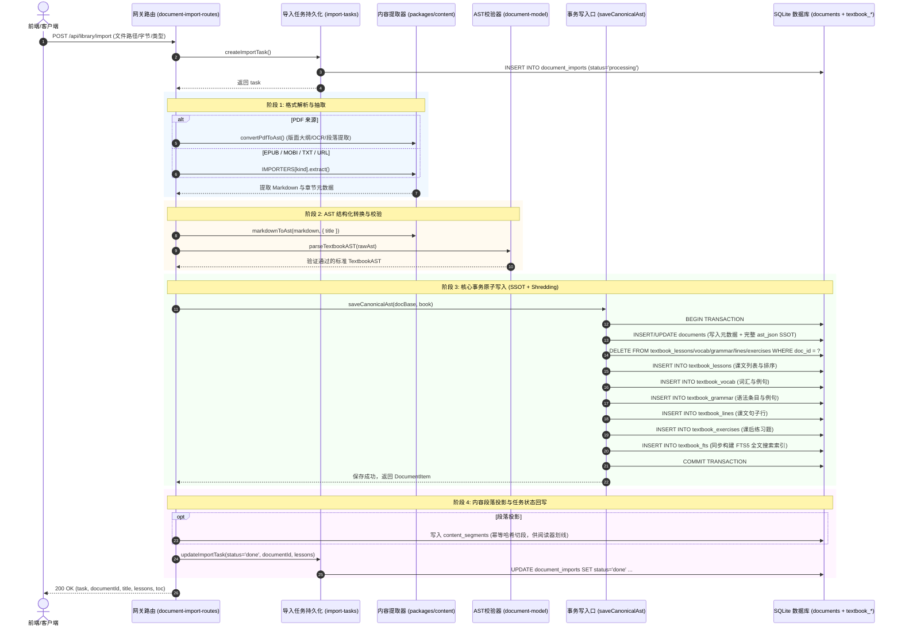
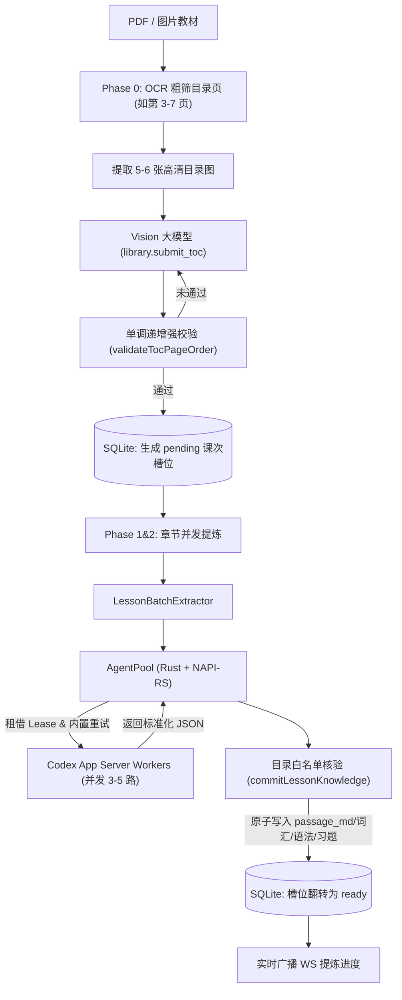

# Lingua Studio - 教材导入架构与数据库表设计规格说明书 (Textbook Import Architecture)

> **版本**：v1.0 (2026-09-29)  
> **面向对象**：后端工程师、架构师、AI Agent  
> **核心原则**：SSOT 底稿与结构化拆行（Shredding）同事务保证、教材六层模型、静态表结构（行表达动态）、强类型防线（Result 模式与 Zod 校验）

---

## 1. 负责模块职责矩阵 (Module Responsibility Matrix)

在 Lingua Studio 的模块化架构中，教材导入不是单一大文件或单一函数，而是由多个专业领域包（Packages）协同完成的分层流水线。

| 模块 / 路径 | 核心职责 | 核心代码文件 |
| :--- | :--- | :--- |
| **网关调度与门面** `apps/gateway (library 模块)` | 负责对外暴露 HTTP API，协调任务生命周期、调用解析器、组合仓储保存，并触发后续段落投影与状态变更。 | - [`document-import-routes.ts`](../apps/gateway/src/modules/library/http/document-import-routes.ts) - [`document-import-service.ts`](../apps/gateway/src/modules/library/application/document-import/document-import-service.ts) - [`pdf-import-service.ts`](../apps/gateway/src/modules/library/application/pdf-import/pdf-import-service.ts) - [`toc-import-prepare.ts`](../apps/gateway/src/modules/library/application/pdf-import/toc-import-prepare.ts) |
| **内容解析与源格式提取** `packages/content` | 负责原生文件字节流解码、大文件段落提取、PDF 版面大纲识别，并转化为标准 Markdown 或草稿对象。 | - `src/document/text-reader.ts` - `src/document/epub-reader.ts` - `src/document/mobi-reader.ts` - `src/pdf/layout-headings.ts` - `src/pdf/markdown-to-ast.ts` |
| **教材 AST 契约与校验** `packages/document-model` | 定义教材六层模型的 Zod 运行时 Schema 与 TS 类型契约，提供强类型解析与防御性拦截。 | - `src/textbook.ts` (`TextbookASTSchema`, `parseTextbookAST`) |
| **数据持久化与拆行内核** `packages/storage-sqlite` | 负责 SQLite 表结构定义、DDL 迁移、任务状态持久化以及**同一事务内 AST 与平铺表全删全插（Shredding）**。 | - `src/schema.ts` - `src/adapters/library/textbook-shred.ts` (`shredIntoTransaction`) - `src/adapters/document/import-tasks.ts` - `src/adapters/library/toc-import-sessions.ts` - `src/adapters/library/content-segments.ts` |

---

## 2. 教材导入全流程原理解析 (Ingestion Lifecycle & Flow)

整个教材导入过程分为 **六大阶段**，确保系统在面临不同体积、不同来源的文件时均具备高可靠性、防双源漂移与断点续存能力：

---

## 3. 涉及数据库表及其字段作用详解 (Schema & Fields Specification)

所有表均已静态固化于 `packages/storage-sqlite/src/schema.ts`，禁止运行时动态建表（按 [AGENTS.md §1.8](file:///d:/project/rust/tauri/study-studio/AGENTS.md#L83-L103)）。

### 3.1 任务控制与导入会话层

#### (1) `document_imports` —— 单文档导入任务台账
记录文件转换的异步/同步状态机，确保大文件解析时前端可轮询且失败可追溯。
- **`id`** (`TEXT`, PK): 任务 ID（如 `import_xxxx`）。
- **`user_id`** (`TEXT`, NOT NULL): 操作用户标识。
- **`source_kind`** (`TEXT`, NOT NULL): 输入文件格式（`pdf` | `epub` | `mobi` | `text` | `url`）。
- **`filename`** (`TEXT`, NOT NULL): 原始文件名。
- **`status`** (`TEXT`, NOT NULL): 状态机取值（`processing` | `done` | `failed`）。
- **`document_id`** (`TEXT`): 成功后关联生成的教材文档 ID。
- **`lessons`** (`INTEGER`): 解析出的有效课数。
- **`error`** (`TEXT`): 异常时的用户友好错误信息（`BusinessError.userMessage`）。
- **`created_at` / `updated_at`** (`TEXT`, NOT NULL): 时间戳。

#### (2) `toc_import_sessions` —— 整书目录规划会话表
针对大体积 PDF 或需要目录人工确认的场景，支持将教材按章节规划切片。
- **`id`** (`TEXT`, PK): 会话 ID。
- **`user_id`** (`TEXT`, NOT NULL): 用户 ID。
- **`request_key`** (`TEXT`, NOT NULL, 唯一索引): `sha256(user + pdfSha256 + planFingerprint)` 服务端重算的幂等键。
- **`plan_fingerprint`** (`TEXT`, NOT NULL): 目录规划指纹。
- **`pdf_sha256`** (`TEXT`, NOT NULL): PDF 源文件哈希。
- **`page_count` / `lesson_count` / `chunk_count`** (`INTEGER`, NOT NULL): 总页数、课数、切片数。
- **`status`** (`TEXT`, NOT NULL): `prepared` | `running` | `completed` | `failed` | `cancelled` | `target_deleted`。
- **`doc_title`** (`TEXT`, NOT NULL): 教材标题。
- **`document_id`** (`TEXT`): 绑定的目标教材文档 ID（首个 chunk 提交成功时生成绑定）。
- **`ast_fingerprint`** (`TEXT`): canonical AST SHA-256 指纹，防止外部追加时状态漂移。
- **`error`** (`TEXT`): 失败原因。
- **`created_at` / `updated_at`** (`TEXT`, NOT NULL)。

#### (3) `toc_import_chunks` —— 目录切片执行进度表
- **`session_id` + `ordinal`** (`TEXT` + `INTEGER`, 复合主键): 所属会话 ID 与切片执行序。
- **`lesson_index` / `lesson_title`** (`INTEGER` / `TEXT`): 课程序号与课文标题。
- **`physical_start` / `physical_end`** (`INTEGER`, NOT NULL): PDF 物理起止页。
- **`chunk_fingerprint`** (`TEXT`, NOT NULL): 切片哈希校验指纹。
- **`status`** (`TEXT`, NOT NULL): `prepared` | `running` | `completed` | `failed`。
- **`attempts`** (`INTEGER`, NOT NULL): 执行重试次数。
- **`error`** (`TEXT`): 错误原因。
- **`updated_at`** (`TEXT`, NOT NULL)。

---

### 3.2 教材主文档层 (Material / Document - 事实源 SSOT)

#### (4) `documents` —— 教材与导入文档主表
整本教材的核心元数据与全量结构体底稿所在。
- **`id`** (`TEXT`, PK): 文档全局唯一 ID（如 `doc_xxxx`）。
- **`user_id`** (`TEXT`, NOT NULL): 归属用户（公共种子为 `system`，用户导入为对应 `userId`）。
- **`title`** (`TEXT`, NOT NULL): 教材名称。
- **`source_kind`** (`TEXT`, NOT NULL): 来源分类（`user_import` | `system` | `ai_generated` | `news`）。
- **`language`** (`TEXT`, NOT NULL): 目标语言代号（`ja` | `en` | `ko`）。
- **`content`** (`TEXT`, NOT NULL): 文本摘要切片（入库恒截前 2000 字符，大文件原文不冗余堆入 DB）。
- **`ast_json`** (`TEXT`): **教材唯一事实源 (SSOT)**，存储完整规范化的 `TextbookAST` JSON。
- **`topic`** (`TEXT`): 主题标签（日常、商务、旅行等）。
- **`difficulty`** (`INTEGER`): 难度级别（1~5）。
- **`source_url`** (`TEXT`): 网页抓取源地址。
- **`source_publisher`** (`TEXT`): 来源标签（如“PDF导入（自有资料）”）。
- **`exam_tag`** (`TEXT`): 目标考试标签（如 `N5` / `CET6`）。
- **`source_kind_detail` / `fetch_status` / `news_publisher`** (`TEXT`): 细粒度扩展字段。
- **`created_at` / `updated_at`** (`TEXT`, NOT NULL)。

---

### 3.3 教材平铺拆行表 (Shredded Entities - 对应六层领域模型)

系统在查询、组卷、词典查词和刷卡时，**严禁反序列化解析全量 `documents.ast_json`**，必须读取由同一事务平铺拆出的以下实体表：

#### (5) `textbook_lessons` —— 课文目录表 (Section 层)
- **`document_id` + `lesson_id`** (`TEXT` + `TEXT`, 复合主键): 锁定特定教材的特定课。
- **`lesson_number`** (`INTEGER`, NOT NULL): 兼容保留字段（允许 gap，不用于 UI 排序）。
- **`title`** (`TEXT`, NOT NULL): 章节标题。
- **`sort_order`** (`INTEGER`): **唯一排序真理**（AST 数组中的连续 index + 1，1-based 连续）。
- **`kind`** (`TEXT`, NOT NULL): 节点层级（`lesson` 课 | `chapter` 章）。
- **`parent_id`** (`TEXT`): 父级章节 ID（可空，实现二级目录树）。

#### (6) `textbook_vocab` —— 教材生词表 (Knowledge Point 词汇)
- **`document_id` + `lesson_id` + `ord`** (`TEXT` + `TEXT` + `INTEGER`, 复合主键): 课内词汇序号（0-based 连续）。
- **`surface`** (`TEXT`, NOT NULL): 词面文本（日文汉字、英文原词等，建有组合索引）。
- **`reading`** (`TEXT`): 读音假名、注音或音标。
- **`pos`** (`TEXT`): 词性标注。
- **`gloss_zh`** (`TEXT`): 中文释义。
- **`pitch`** (`TEXT`): 声调标识（如 `⓪`、`①`）。
- **`example_ja` / `example_zh`** (`TEXT`): 原文生词例句及中文翻译。

#### (7) `textbook_grammar` —— 语法要点表 (Knowledge Point 语法)
- **`document_id` + `lesson_id` + `ord`** (`TEXT` + `TEXT` + `INTEGER`, 复合主键): 课内语法序号。
- **`title`** (`TEXT`, NOT NULL): 语法条目名称。
- **`connection`** (`TEXT`): 接续形式规则。
- **`explanation`** (`TEXT`): 语法详细解说。
- **`examples_json`** (`TEXT`, NOT NULL): 例句数组 JSON（形如 `[{"japanese":"...","chinese":"..."}]`，上限 10 条）。

#### (8) `textbook_lines` —— 对话与课文行表 (Content Block 层)
- **`document_id` + `lesson_id` + `ord`** (`TEXT` + `TEXT` + `INTEGER`, 复合主键): 行顺序号。
- **`speaker`** (`TEXT`): 对话角色名（如“田中”）。
- **`ja`** (`TEXT`, NOT NULL): 目标语言原文句子。
- **`zh`** (`TEXT`): 对应中文翻译。

#### (9) `textbook_exercises` —— 自带课后习题表 (Exercise 层)
- **`document_id` + `lesson_id` + `ord`** (`TEXT` + `TEXT` + `INTEGER`, 复合主键): 习题序号。
- **`exercise_id`** (`TEXT`): 习题业务 ID。
- **`type`** (`TEXT`, NOT NULL): 题型（`CHOICE` | `FILL_BLANK` | `TRANSLATION`）。
- **`prompt`** (`TEXT`, NOT NULL): 题目题干。
- **`options_json`** (`TEXT`, NOT NULL): 选择题选项 JSON。
- **`answer`** (`TEXT`, NOT NULL): 标准答案。
- **`explanation`** (`TEXT`): 习题讲解与答案说明。

---

### 3.4 索引与衍生投影层

#### (10) `textbook_fts` —— 全文检索虚拟表 (SQLite FTS5)
内容感知 FTS5 虚表，与 shred 同步重建：
- **`surface`, `reading`, `gloss`**: 词汇词面、读音、释义。
- **`ja`, `zh`**: 对话行原文与译文。
- **`document_id`, `lesson_id`** (`UNINDEXED`): 归属文档与课文。
- **`kind`** (`UNINDEXED`): 节点类别（`vocab` | `line`）。
- **`ref`** (`UNINDEXED`): 锚点定位字符串（如 `l1#v0`, `l1#d2`）。

#### (11) `content_segments` —— 内容段落寻址投影表
将教材正文做统一幂等切段，供前端阅读器高亮与划线取词精准定位：
- **`id`** (`TEXT`, PK): 段落全局 ID。
- **`document_id`** (`TEXT`, NOT NULL): 对应文档 ID。
- **`lesson_id`** (`TEXT`, NOT NULL): 对应课文 ID（直属文档为空串）。
- **`ord`** (`INTEGER`, NOT NULL): 顺序号。
- **`kind`** (`TEXT`, NOT NULL): 段落类型（`sentence` | `paragraph` 等）。
- **`text`** (`TEXT`, NOT NULL): 段落正文字符串。
- **`start_offset` / `end_offset`** (`INTEGER`): 在文档中的绝对字符偏移。
- **`hash`** (`TEXT`, NOT NULL, 唯一索引): 幂等计算哈希，杜绝重复切段。
- **`created_at`** (`TEXT`, NOT NULL)。

---

## 4. 架构设计不变量与质量保证 (Architectural Invariants & Guarantees)

1. **零双源漂移 (Zero Dual-Source Drift)**：
   - 必须通过 `saveCanonicalAst()` 统一写入口。
   - `documents.ast_json` 写入与 `textbook_*` 的全删全插**必须处于同一个数据库事务内提交**。如果 shred 失败，整笔操作整体 rollback，严禁产生“底稿已存但行表为空”的孤儿状态。
2. **读侧永不抛 (Non-Throwing Reads & Fallback)**：
   - 数据库读取 TEXT 转换枚举时，未知或脏数据回退中性默认值，杜绝因旧数据损坏导致整个应用崩溃。
3. **类型防线先行 (Zod Validation First)**：
   - Markdown 解析为 AST 后，必须经过 `parseTextbookAST()`（基于 Zod）安全校验，拦截重复 lesson ID、缺漏必填项等脏数据后再进入持久化通道。
4. **统一错误表达 (Result<T, BusinessError>)**：
   - 导入流程严禁向客户端抛出未受控的底层异常（如 `ENOENT`, `SyntaxError`），一律由 `translateToBusinessError` 收敛为带有安抚性自然语言解释的业务错误对象。

---

## 5. AI-Native 目录优先与 AgentPool 并发提炼架构 (v031+)

为了克服传统 OCR 机械碎行解析杂乱、大模型并发上下文污染和长任务偶发失败的痛点，系统在 v031 升级了全新的 AI-Native 流水线：

### 5.1 关键组件与职责分工

1. **骨架优先与槽位化减法 (v031)**：
   - 课文不再机械切碎落入 `textbook_lines`，直接升级为本课整篇精读课文 Markdown（`passage_md`）；
   - `textbook_lessons` 扩充 `start_page`, `end_page`, `status`（'pending' | 'ready'），先生成骨架槽位，再由章节并发提炼回填。
2. **`agentpools` 多运行时 Worker 调度引擎**：
   - **包名**：`agentpools@0.1.0`（基于 Rust 原生内核驱动的 Node-API 模块）；
   - **独占租借（Lease）**：Worker 槽位在 `lease.acquire()` 到 `lease.finish()` 期间绝对锁定，彻底杜绝并发插队污染上下文；
   - **并发限制与排队**：后台常驻 3~5 个 Worker，全书数十课自动进入 `maxQueued` 缓冲队列有序提炼；
   - **完备的重试与错误隔离**：针对网络抖动、模型超时自动重试；单课失败不影响批处理全局，错误妥善聚合。
3. **双重白名单对齐保障**：
   - 大模型调用 `commitLessonKnowledge` 时强制校验 `(documentId, lessonId)` 槽位是否存在，脱离预置目录造课直接拦截抛出 `E_TOC_SLOT_NOT_FOUND`，杜绝大模型并发时的幻觉造课。

