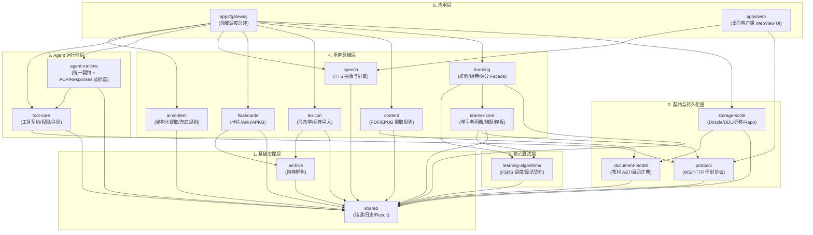

# `packages/` — 核心能力包阅读指南

`packages/` 是 Lingua Studio 的共享能力层。这里的代码会被 `apps/gateway`、`apps/web` 或 Agent 适配器复用。

本目录采用**按能力拆分的模块化单体结构（Modular Monolith）**：各 Package 并非独立部署的微服务，而是通过 workspace 依赖协同工作的自治模块。

```text
packages/
├── shared                 # [基础支撑] Result、业务错误、统一日志、通用工具
├── archive                # [基础支撑] 纯内存防炸弹解包器（tar.gz/zip）
├── storage-sqlite         # [持久化层] Drizzle Schema、DDL、迁移与 Repository 实现
├── protocol               # [契约模型] 客户端 ↔ Gateway 通信信封与事件协议
├── document-model         # [契约模型] 教材 AST、目录正典化与任务规划契约
├── learning-algorithms    # [核心算法] FSRS v1 调度算法与版本化算法契约
├── learner-core           # [学习领域] 学习者画像、错题本、音调图谱与卡片模板
├── learning               # [学习领域] 学习领域编排 Facade（排程、组卷与评分）
├── flashcards             # [学习领域] 闪卡模板渲染、AnkiConnect 同步与 APKG 解析
├── lexicon                # [语言领域] 多语言形态学分析（分词/词干）与词典包导入
├── content                # [内容规则] 教材切块、PDF/EPUB 摄取纯规则
├── speech                 # [语音能力] TTS 引擎抽象、Azure 实现与音色匹配
├── ai-content             # [内容规则] AI 宽容解析、结构化题包与确定性规则兜底
├── tool-core              # [Agent 核心] Tool 契约定义、权限体系与注册中心
└── agent-runtime          # [Agent 核心] 统一 Agent 抽象契约与 Responses/ACP 适配器
```

---

## 1. Package 层的六层架构拓扑

整个系统的能力自底向上划分为六个清晰层次，保持严格的单向无环依赖：

| 层级 | 包含的 Package | 核心职责 |
|---|---|---|
| **6. 终端与网关** | `apps/gateway`, `apps/web` | 服务装配、HTTP/WS 路由、UI 呈现与状态管理 |
| **5. Agent 运行时** | `agent-runtime`, `tool-core` | Agent 契约抽象、引擎协议适配（ACP/Responses）、工具注册与调度 |
| **4. 垂直业务领域** | `learner-core`, `learning`, `flashcards`, `lexicon`, `content`, `speech`, `ai-content` | 学习闭环、语言形态学、闪卡制作、教材解析、发音与内容提炼 |
| **3. 核心算法层** | `learning-algorithms` | 纯数学与统计调度（FSRS v1 等），无 IO、无平台绑定 |
| **2. 契约与持久化** | `protocol`, `document-model`, `storage-sqlite` | 通信协议（WS 信封/事件）、文档模型 AST、SQLite 存储与 Drizzle Schema |
| **1. 基础支撑层** | `shared`, `archive` | Result/BusinessError 范式、日志门面、安全内存解包 |

### 架构依赖图谱 (Mermaid)



---

## 2. 开发者阅读与工作流导航

根据你的开发任务，推荐遵循以下阅读与开发链路：

| 任务场景 | 涉及的核心 Package 路径 | 关键关注点 |
|---|---|---|
| **改动数据库表或增加字段** | `storage-sqlite` | 严格遵守 `ddl.ts`、`schema.ts`、`migrations/vNNN-*.ts` 三者同步；禁止运行时动态建表 |
| **修改教材导入与章节划分** | `document-model` → `content` → `apps/gateway` | 目录正典化、页码单调递增校验、纯切片规则与 AgentPool 会话池装配 |
| **调整复习排程与 FSRS 算法** | `learning-algorithms` → `learner-core` → `learning` | 纯数学调度（保持纯函数）、学习资产持久化契约 |
| **生词卡片渲染与 Anki 导出** | `flashcards` → `learner-core` | 卡片模板语法、APKG 二进制结构与 AnkiConnect 协议 |
| **分词与词典导入** | `lexicon` → `archive` | 形态学还原（deinflect）、词条索引、纯内存安全解压 |
| **新增 Agent 工具 (Native Tool)** | `tool-core` → `apps/gateway/src/modules/*/tools/` | 声明权限级别与 Zod Schema，在 Gateway ToolRouter 中完成进程内注册 |
| **调整 Agent 引擎适配** | `agent-runtime` (`contracts` / `adapters/acp`) | 遵守零厂商泄漏原则，维护 ACP 会话与工具桥接 |
| **调整语音发音与 TTS 播放** | `speech` | Azure 引擎、Web 语音插件与发音音色自动匹配 |

---

## 3. 各 Package 深度解析

### 3.1 基础支撑层 (`shared`, `archive`)

#### `packages/shared`
- **定位**：全工程最底层基石，零本仓库内部依赖。
- **核心模块**：
  - `result.ts`：提供 Rust 风格的 `Result<T, E>`、`ok`、`err`。
  - `errors.ts`：系统级 `BusinessError` 契约，以及底层异常到业务友好的翻译链（`translateToBusinessError`）。
  - `logger.ts`：全局结构化日志门面（业务代码严禁散落 `console.*`）。
  - `id.ts`、`time.ts`：纳秒/时间戳与前缀 ID 生成器。
  - `language.ts`：语言标签正典化。

#### `packages/archive`
- **定位**：轻量级纯 TypeScript 内存解包库。
- **核心特性**：
  - 支持 `tar.gz` 和 `zip` 格式的纯内存解析，不依赖外部命令行或文件系统临时写盘。
  - **内置 300MB 解压防炸弹机制**，确保外部不可信的词典包或教材包导入时不会耗尽系统内存。

---

### 3.2 契约与持久化层 (`protocol`, `document-model`, `storage-sqlite`)

#### `packages/protocol`
- **定位**：桌面客户端 WebView ↔ Agent Gateway 之间的通信边界契约。
- **核心模块**：
  - `envelope.ts`：统一 WebSocket 信封（版本、会话 ID、Turn ID、Payload）。
  - `events.ts`：客户端与服务端的双向事件枚举（`client.turn.send`, `agent.text.delta`, `agent.tool.call` 等）。
  - `schemas/*`：Zod 强类型校验器（题包、答题批改、学习画像、卡片、新闻等）。

#### `packages/document-model`
- **定位**：教材正典模型与任务规划中枢，从原 protocol 独立出来，保证纯粹性。
- **核心模块**：
  - `toc-entries.ts`：目录条目正典化 (`canonicalizeTocEntries`)、页码单调递增性校验 (`validateTocPageOrder`)。
  - `lesson-content.ts`、`chapter-source.ts`：章节内容 AST（文本段落、生词、语法、练习题、图片引用）。
  - `pipeline-settings.ts`：教材流水线参数配置 Zod Schema。
  - `import-monitor.ts`：教材导入流水线的多维度打点监控器类型。

#### `packages/storage-sqlite`
- **定位**：Lingua Studio 的持久化唯一事实源（SSOT）。
- **核心模块**：
  - `schema.ts`：Drizzle ORM 表模型定义（教材表、知识点、生词、错题、学习画像等）。
  - `ddl.ts`：原生建表 SQL 与迁移执行器（保证建库幂等与零漂移）。
  - `migrations/`：正向单向版本化迁移脚本 (`v001` ~ `vNNN`)。
  - `connection.ts`：Bun-SQLite 数据库生命周期管理与连接池。
  - `doctor.ts`、`repair-apply.ts`：数据库自愈、外键巡检与损坏修补套件。
- **规范铁律**：严禁运行时动态建表（加实体一律加行）；严禁裸写拼接 SQL（Drizzle First）；新增表必须三位一体（`ddl.ts` + `schema.ts` + `migrations/`）。

---

### 3.3 算法与学习领域层

#### `packages/learning-algorithms`
- **定位**：纯计算的认知记忆与复习调度算法包。
- **核心模块**：
  - `contracts.ts`：版本化排程器契约接口 (`Scheduler`)。
  - `fsrs-v1.ts`：Free Spaced Repetition Scheduler (FSRS) v1 完整数学实现，纯函数运算，零 IO。

#### `packages/learner-core`
- **定位**：学习者领域持久状态与长期资产模型。
- **核心模块**：
  - `types.ts`：学习者画像、熟练度等级、技能树指标、错题生命周期。
  - `card-templates.ts`：词汇卡、语法卡、近义辨析卡等双向渲染模板。
  - `pitch-graph.ts`：日语声调高低音曲线数据模型。
  - `daily-plan.ts`：每日学习规划领域规则。

#### `packages/learning`
- **定位**：学习领域的高阶 Facade 门面，聚合排程、组卷与评估。
- **核心模块**：
  - `practice/`：客观题批改器 (`objective-grading.ts`)、组卷蓝图 (`assessment-blueprint.ts`)。
  - `analysis-snapshot.ts`：学习进度与薄弱项快照装配器。

#### `packages/flashcards`
- **定位**：生词卡制作、本地预览与外部学习软件互通。
- **核心模块**：
  - `anki-push.ts`：通过 AnkiConnect REST API 向本地 Anki 推送卡片与同步。
  - `apkg-import.ts`、`apkg-analyze.ts`：Anki `.apkg` 导出包的纯 TS 解析与解构。
  - `card-preview.ts`：闪卡正反面富文本预览。

#### `packages/lexicon`
- **定位**：语言形态学与本地离线词典服务。
- **核心模块**：
  - `morphology/`：日语动词/形容词活用还原 (`deinflect.ts`)、韩语词形变化 (`hangul.ts`, `ko-deinflect.ts`)、英语词干提取 (`en-stem.ts`)。
  - 词典二进制包与索引解析，支持客户端在离线状态下实现毫秒级划词查词。

---

### 3.4 内容摄取与多模态层 (`content`, `speech`, `ai-content`)

#### `packages/content`
- **定位**：纯规则驱动的课文与阅读材料摄取层。
- **核心模块**：
  - `document/`：PDF 与 EPUB 结构解构（只保留无本地 C++ 依赖的纯 TS 规则）。
  - 章节切片与物理页码对应。

#### `packages/speech`
- **定位**：发音与语音合成服务抽象。
- **核心模块**：
  - `engine.ts`：TTS 引擎抽象接口。
  - `azure.ts`：Azure Cognitive Speech API 客户端实现。
  - `plugin.ts`：本地客户端 Web Speech API 或三方插件桥接。
  - `voice-match.ts`：根据语种、性别和场景自动优选声音模型。

#### `packages/ai-content`
- **定位**：AI 提炼内容的确定性清洗与本地规则回退。
- **核心模块**：
  - `analysis-rules.ts`：大模型提取输出的宽容度解析器（Markdown 代码块自愈、脏 JSON 修复、必填字段收敛）。
  - `analysis-generate.ts`：纯确定性离线学情报告生成器（当无可用模型或网络离线时提供可用分析）。

---

### 3.5 Agent 契约与运行时层 (`tool-core`, `agent-runtime`)

#### `packages/tool-core`
- **定位**：系统工具（Tool）契约与权限边界。
- **核心模块**：
  - `tool.ts`：工具输入输出定义、执行签名（必须返回 `Result<T, BusinessError>`）。
  - `permissions.ts`：四级安全控制（`READ`, `WRITE`, `DESTRUCTIVE`, `SENSITIVE`）。
  - `registry.ts`：工具注册表，支持位置划分（`SERVER` 在网关进程执行，`CLIENT` 下发 WebView 执行）。

#### `packages/agent-runtime`
- **定位**：大模型与 Agent 对话运行时的统一抽象中枢。
- **设计原则**：**严格的零厂商泄漏（Zero Provider Leak）**。
- **核心模块**：
  - `contracts/`：抽象端口（`AgentAdapter`, `AgentSession`, `AgentEvent`, `ContextSnapshot`）。
  - `adapters/acp/`：ACP 协议适配器（多轮会话、图片附件、MCP 工具桥接、权限确认）。
  - `adapters/responses/`：基于轻量单次响应模式的旁路适配器。

---

## 4. 关键跨 Package 数据流实战

### 4.1 教材导入与批量抽取流

```text
[用户选择 PDF]
      │
      ▼
document-model (validateTocPageOrder 校验目录页码)
      │
      ▼
content (producePdfLessons 提取文本或渲染图片批次)
      │
      ▼
agent-runtime (ChapterSessionPool 注入 ContextSnapshot 与图片附件)
      │
      ▼
tool-core (Agent 调用 textbook_content_submit 工具)
      │
      ▼
ai-content (宽容校验 AST 结构、题型枚举)
      │
      ▼
storage-sqlite (单课事务写入 textbook_articles, textbook_vocabulary 等)
```

### 4.2 每日复习与 FSRS 卡片调度流

```text
apps/web (用户作答评级: Again / Hard / Good / Easy)
      │
      ▼
protocol (WS 信封发送 card.review.submit)
      │
      ▼
learning (调用学习领域门面)
      │
      ▼
learning-algorithms (fsrs-v1 纯数学计算新的 stability, difficulty, due)
      │
      ▼
storage-sqlite (写入 review_logs，更新 user_cards 状态)
```

---

## 5. 架构铁律与工程规范

所有对 `packages/` 贡献代码的工程师与 AI Agent 必须遵守以下铁律：

1. **Provider Zero Leak（零厂商泄漏）**：
   - 严禁在 `shared`, `protocol`, `learner-core`, `tool-core`, `content`, `apps/web` 中直接 `import` 任何外部大模型 SDK（如 `@openai/*`, `codex-*`）。必须经由 `agent-runtime/contracts` 交互。
2. **SSOT 归于领域包与数据库**：
   - 学习者的掌握度、卡片排程与错题记录由 `storage-sqlite` 和 `learner-core` 掌控，**绝不保存在大模型会话历史中**。
3. **ContextSnapshot 优先于反向 Read Tool**：
   - 界面已知事实（当前题干、用户答案、等级）随 Turn 通过快照注入；严禁让 Agent 反向调用工具索取界面已知信息。
4. **原生 Tool 优先于 MCP**：
   - 系统内置业务工具优先走 `tool-core` 原生注册与进程内分发；MCP 仅作为可选的外部异构系统（Anki/Notion）桥接。
5. **类型安全与 Hygiene**：
   - 全仓库严禁新增 `as any` 或 `: any`；所有外部输入一律先收窄。
   - 错误传递全面采用 `Result<T, BusinessError>`，业务代码禁止散落 `console.*`，统一采用 `@study-studio/shared` 的 `logger`。
6. **导出白名单制（No Wildcard Drift）**：
   - 新增领域包优先采用白名单具名重导出，严禁野性 `export *` 污染命名空间。